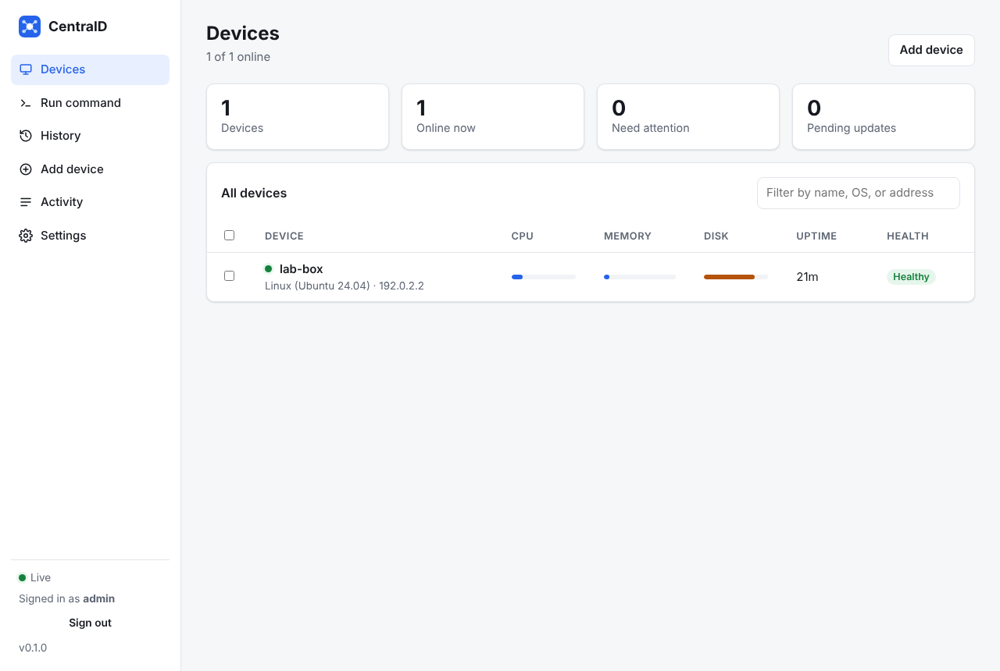
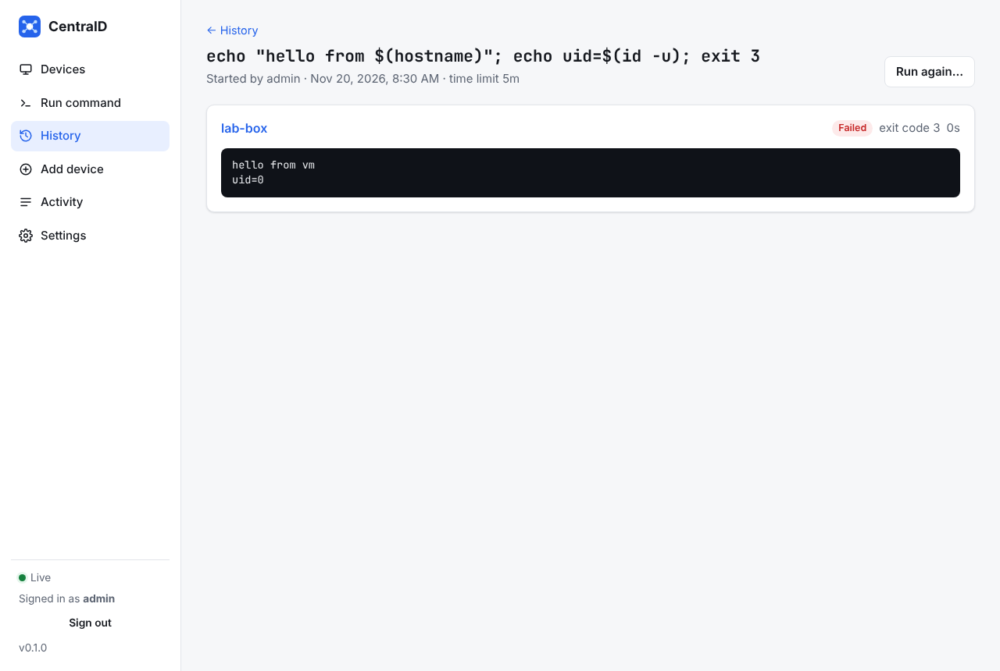
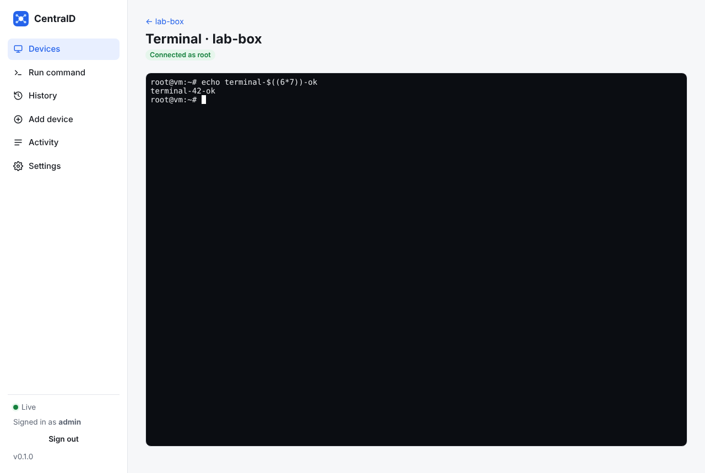

# CentralD

Remote management for your home lab. CentralD shows the health of every Linux
and Windows machine you own and lets you run commands, open a terminal, and
install updates on them from one web app.



- **Live health**: CPU, memory, disks, uptime, and addresses. On Linux it also
  shows pending updates, whether a reboot is needed, and failed services.
- **Commands on many machines**: output streams back as it arrives, exit codes
  are recorded, and you can cancel and set time limits.
- **A terminal in the browser**: a real interactive shell on any machine.
- **One-click maintenance**: check for and install updates (apt, dnf, pacman),
  and reboot.
- **Easy to add machines**: select **Add device**, copy one command, and paste
  it on the machine.
- **Secure by default**:
  - Agents and install commands pin the server's key, so there is no trust on
    first use.
  - Join codes are single-use and never put on a command line.
  - Sign-in has two-factor codes and throttling, and there is an activity log.
  - Machines enrolled as **monitor-only** refuse every command themselves.

| Command output                               | Terminal                                 |
| -------------------------------------------- | ---------------------------------------- |
|  |  |

## Install

You need one always-on Linux machine for the server. The machines you manage can
run Linux (x86_64 or ARM64) or Windows 10/11 (x86_64 or ARM64). Keep CentralD on
your LAN or a VPN, not the public Internet.

Download the server package from the
[latest release](https://github.com/BurntToasters/centrald/releases):

```sh
sudo apt install ./centrald-server_*_amd64.deb    # Debian, Ubuntu, Raspberry Pi OS
sudo dnf install ./centrald-server-*.x86_64.rpm   # Fedora
makepkg -si                                       # Arch (PKGBUILD in the release)
```

The server starts at once and prints its address and a one-time setup code:

```text
Open the web app at:
  https://192.168.1.10:7443

Setup code: K7PX-2MQD-9RTA
```

Open the address, enter the code, and create your account. Then select **Add
device** and run the command it gives you on each machine.

The [Quickstart](docs/QUICKSTART.md) walks through every step.

## Documentation

| Guide                                           | For                                             |
| ----------------------------------------------- | ----------------------------------------------- |
| [Quickstart](docs/QUICKSTART.md)                | Install and add your first machine              |
| [User guide](docs/GUIDE.md)                     | Everyday tasks in the web app                   |
| [Operations](docs/OPERATIONS.md)                | Settings, certificates, backups, upgrades, help |
| [Security model](docs/THREAT_MODEL.md)          | What CentralD protects and its limits           |
| [Architecture](docs/ARCHITECTURE.md)            | How the pieces work                             |
| [Releases](docs/RELEASES.md)                    | Verifying downloads, building from source       |
| [Project status](docs/IMPLEMENTATION_STATUS.md) | What works today and what is planned            |
| [Security policy](SECURITY.md)                  | Reporting vulnerabilities                       |

The same documentation is at [centrald.dev](https://centrald.dev).

## Development

Requirements: Rust (stable, via `rustup`) and Node.js 24.22.1+ or 26.13.0+.

```sh
npm ci
npm run dev:server   # server from source on https://127.0.0.1:7443
npm run dev:web      # web app with live reload, proxied to the server
npm run e2e          # full end-to-end suite; report in e2e-report/
npm run package      # .deb, .rpm, tarballs, and PKGBUILD in dist/
```

Before sending a change, run `npm run format:check`, `npm run lint`,
`npm run typecheck`, `npm test`, `npm run test:rust`, and `npm run e2e`.

```text
crates/centrald-proto    wire messages, join codes, TLS pinning
crates/centrald-server   HTTPS server, SQLite, sessions, installers
crates/centrald-agent    status, commands, terminal, enrollment, self-update
web/                     React web app (embedded in the server)
tests/e2e/               Playwright suite against the real binaries
packaging/               systemd units and package hooks
```

## License

CentralD is free software under the
[GNU General Public License v3.0 or later](LICENSE).
